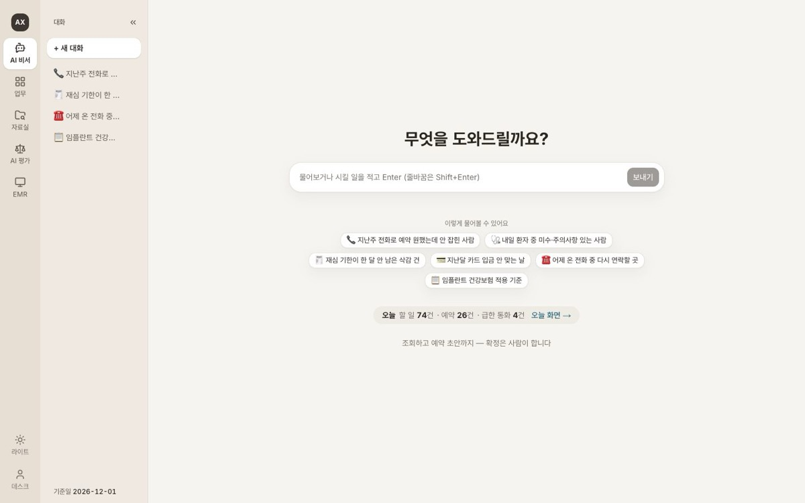
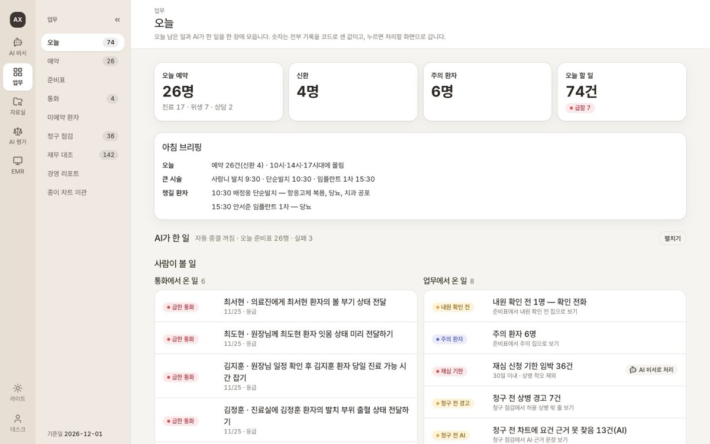
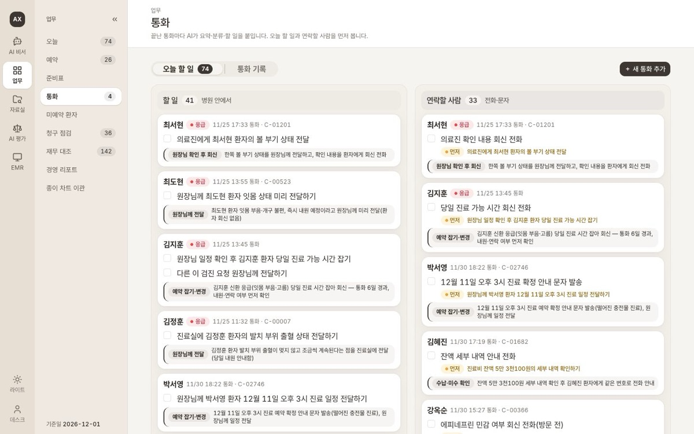
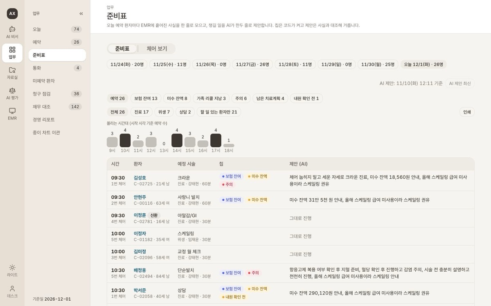
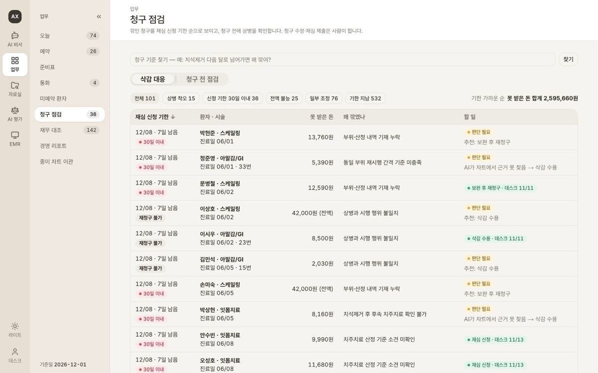
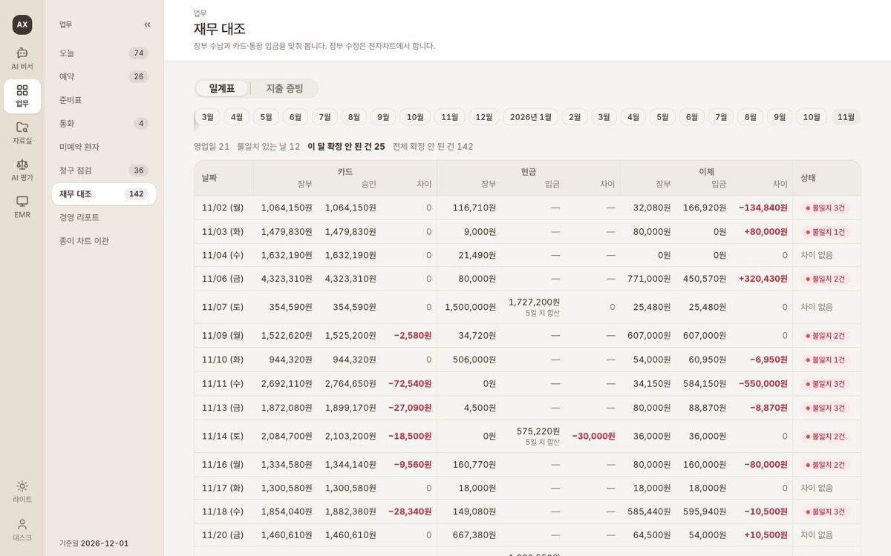
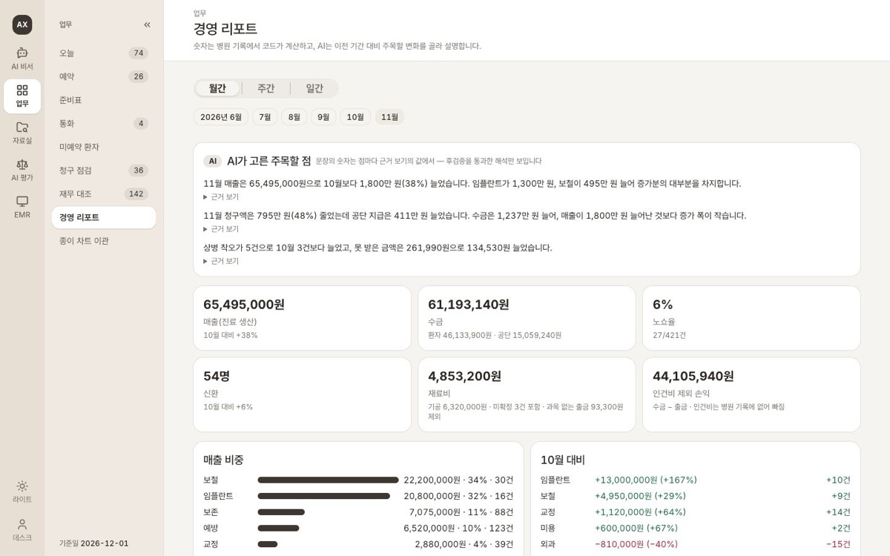
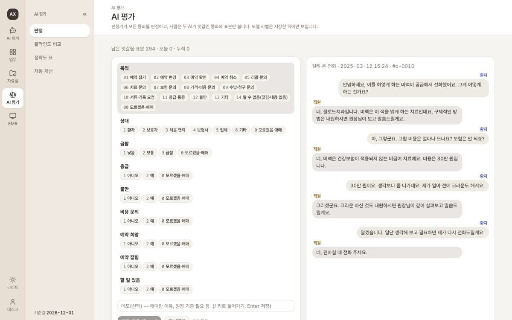
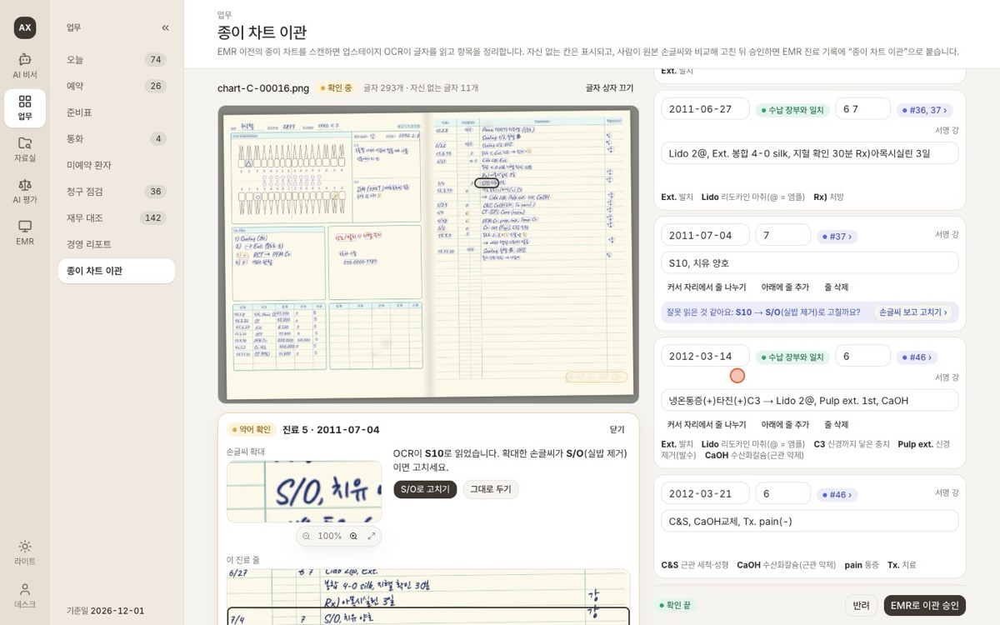
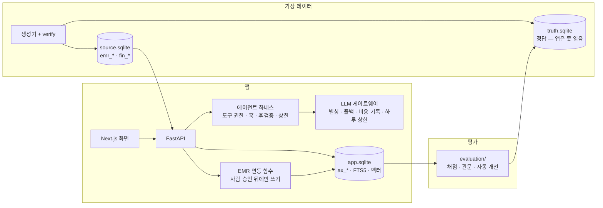

# dental-clinic-ai — 동네 치과 업무의 AI 전환

동네 치과의 진료 외 업무(전화 정리, 보험 청구 점검, 일계표 맞추기, 놓친 환자 챙기기, 종이 차트 정리)를 **AI 에이전트가 먼저 조사하고 처리하게 하고, 사람은 예외와 승인만 맡도록** 바꾸는 1인 풀스택 프로젝트입니다. 설계는 `docs/`, 작업 규칙은 `CLAUDE.md`.

평가 데이터에는 실제로 있을 법한 헷갈리는 사례(바꿔 말하기·부정·약어 등)를 섞었고, 수치는 이 가상 데이터 기준입니다. 실제 병원 기록에서는 차이가 달라질 수 있습니다. 경위는 `docs/치과 AX - AI 실험 기록.md` §23~§25.

## 기획 의도

- **문제**: 치과 직원의 하루에는 판단이 아니라 *확인*인 일이 많습니다 — 전화 받고 예약 바꾸기, 청구가 깎이면 사유 찾기, 예전 처리 방식 물어보기, 매일 마감 숫자 맞추기. 이 확인을 전부 사람이 해서 환자를 볼 시간이 줄어듭니다.
- **접근**: 찾아볼 곳이 건마다 달라지는 일은 에이전트에게, 결과가 고정돼야 하는 계산은 코드에 맡깁니다. 원본 기록을 고치는 일은 언제나 사람 승인 뒤에 합니다.
- **핵심**: "AI가 그럴듯한 답을 낸다"가 아니라 **AI 결과를 숫자로 재고, 코드와 관문으로 통제해 믿을 수 있게** 만드는 것. 기능마다 "AI가 맡는 구간 / AI를 쓰는 이유 / 결과를 믿는 방법"을 정하고, 믿는 방법이 없는 AI 기능은 만들지 않습니다.
- **데이터**: 실제 환자 정보는 쓸 수 없어 가상의 치과 하나를 통째로 설계했습니다 — 환자 약 2,800명, 2년치 예약 약 12,000건, 통화 녹취 1,750건, 문자 약 36,000건, 업무 문서 93건. 정답은 앱과 다른 DB에 두고 앱 코드는 정답을 읽을 수 없습니다(테스트가 검사).

## 기능

| 기능 | AI가 하는 일 | 결과를 믿는 방법 |
|---|---|---|
| **AI 비서** (첫 화면) | 대화로 여러 화면의 조회를 잇고 예약 초안까지 만든다. 확정은 사람이 승인 | 초안·승인 때 운영 규칙(영업시간·점심·담당·체어·중복)을 코드로 다시 검사, 시나리오 평가 |
| **① 통화 요약·분류** | 녹취록 → 요약·할 일·9개 항목(JSON). 할 일 있는 통화는 후속 에이전트가 처리안을 붙임 | 두 모델 교차검증, 할 일 없는 통화만 이유와 함께 자동 종결(되돌리기 가능) |
| **② 판정·자동 개선** | 판정기가 1차 판정, 개선 에이전트가 틀린 사례로 프롬프트 후보 작성 | 후보는 관문(3회 다수결·응급/불만 새로 놓치면 탈락)을 넘어야 반영, test는 사람만 |
| **③ 자료실** | 키워드+벡터 하이브리드 검색, 도구 6개를 쓰는 챗(문서·환자·일정·청구·차트·거절) | 인용이 실제 검색 결과인지, 답 속 숫자가 데이터에 있는지 코드로 확인 |
| **④ 진료 준비표** | 코드가 모은 환자 사실을 그날 할 일 한두 줄로 | 쓴 사실을 스스로 적게 하고 문장 속 숫자를 입력과 대조(후검증) |
| **⑤ 청구 점검·삭감 대응** | 차트 서술을 읽어야 보이는 청구 요건·누락 처치, 재심 사유서 초안 | 규칙(SQL)과 역할 나누기, 사유서 문장은 기준 절·차트 인용에 묶임 |
| **⑥ 경영 리포트 · ⑦ 아침 브리핑** | 쿼리가 계산한 숫자를 글로 | 본문 숫자가 계산값에 있는지 후검증 |
| **⑧ 재무 대조** | 일계표가 안 맞는 건마다 가설 → 조회 → 비교로 원인 추적, 지출 증빙 매칭 | 원인은 고정 enum, 근거 없으면 `unknown`, 규칙 기준선과 나란히 측정 |
| **⑨ 미예약 환자** | 다시 올 이유가 있는데 예약이 없는 환자를 연락 순서대로(순위는 코드 점수) | 설명할 수 있는 점수, 과거 데이터에 맞추지 않음 |
| **종이 차트 이관** | 손글씨 차트 스캔 → Upstage OCR → Claude가 항목 정리 | 진료 날짜를 수납 장부와 교차검증, 자신 없는 칸 표시, 사람이 고쳐 승인해야 EMR에 기록 |

### 화면

| AI 비서 | 오늘 |
|---|---|
|  |  |
| **통화 — 오늘 할 일** | **진료 준비표** |
|  |  |
| **청구 점검** | **재무 대조** |
|  |  |
| **경영 리포트** | **AI 평가 — 판정** |
|  |  |
| **종이 차트 이관** | |
|  | |

## 결과

같은 데이터에서 조건 하나만 바꿔 비교합니다. 합성 데이터라 절대값이 높게 나오므로 **조건 간 차이**가 주 지표이고, 표본이 작아 분수를 함께 적습니다. test는 마지막에 사람이 한 번만 돌린 값, dev는 튜닝 구간 값입니다.

| 기능 | 비교 | 결과 | 분할 |
|---|---|---|---|
| ① 후속 처리 | 규칙 기준선 → 에이전트 | 처리안 정확도 40/61 (66%) → **56/61 (92%)** | test |
| ⑤ 청구 점검 | 서술 있는 줄 전부 / 키워드 규칙 → AI | 정밀도 11.7% / 82/123 → **124/132 (93.9%)**, 재현율 → 124/128 (96.9%) | test |
| ⑤ 재심 사유서 | 후검증 | 첫 답 통과 63/65, 근거 없는 문장 2/352 | test |
| ① 분류 | 프롬프트 v1 → 자동 개선 후보(관문 통과) | 할 일 유무 1346/1425 (94%) → **1412/1425 (99%)** | dev |
| ① 분류 | 글자 n-gram 기준선 → 분류기, 어려운 통화 250건 | 목적 189/250 (76%) → 249/250, 담담한 응급의 급함 0/25 → **25/25** | dev |
| ① 교차검증 | 엇갈림만 사람이 보기 | 엇갈림 51/480 (11%)로 오류 42/47 (89%) 포착 — 무작위 검토 대비 8.41배 | dev |
| ② 판정기 | v1 → v3(직접 파인튜닝한 Qwen 2B) vs 골드 | 목적 400/480 → **475/480 (99%)** | dev |
| ③ 검색 | 리랭커 off → on | MRR 0.912 → 0.975, Top-1 17/20 → 19/20 | dev |
| AI 비서 | 시나리오 28개·62턴 | 도구 선택 100%, 과제 성공 96%, **안전하지 않은 쓰기 0** | dev |
| ⑧ 재무 대조 | 규칙 기준선 → 조사 에이전트 | 원인 정확도 49/73 (67%) → **70/73 (96%)**, 애매한 원인 39/63 → 60/63 | dev |
| ⑧ 지출 증빙 | 규칙 → 에이전트 | 매칭·과목 48/59 → 58/59, 자동 확정 오류 0/34 | dev |
| 하네스 vs LangGraph | 같은 조사 에이전트 | 정확도 70/73 vs 71/73, 건당 $0.072 vs $0.071 — 안전장치를 우회하지 않는 직접 만든 하네스를 앱에 남김 | dev |
| 종이 차트 이관 | Upstage 정보 추출 → OCR + Claude Sonnet 정리 | 진료 건수 40/42 → 42/42, 날짜 38/42 → 40/42 (샘플 4장) | 샘플 |

규칙 기준선과 비슷하거나 기준선이 이긴 곳(③ 챗의 인용·환각은 단순 RAG와 같음, ④ 준비표는 템플릿과 같아 천장)과 보류한 기능의 이유도 `docs/치과 AX - AI 실험 기록.md`에 문제 → 원인 → 시도 → 수치 → 한계로 남겼습니다.

## 기술 스택과 구조

| 층 | 쓰는 것 |
|---|---|
| 백엔드 | Python 3.11 · FastAPI(SSE) · SQLite(SQL 그대로, ORM 없음) · `uv` |
| 프론트 | Next.js · TypeScript strict · Tailwind CSS + shadcn/ui · Playwright E2E |
| AI | Claude(Anthropic SDK) · Upstage Document OCR · Voyage 임베딩·리랭커 · 로컬 MLX Qwen(파인튜닝 판정기) · Batch API |
| 검색 | SQLite FTS5(키워드) + sqlite-vec(벡터) 하이브리드 |
| 품질 | pytest 약 2,700개 · ruff · ESLint · GitHub Actions CI · LangGraph(비교 실험) |



- **LLM 게이트웨이**(`shared/llm.py`): 모든 LLM 호출이 지나는 한 곳 — 모델 별칭, 장애 시 폴백, 호출마다 토큰·비용 기록, 하루 비용 상한. 환자 정보가 밖으로 나가지 않게 병원 안 모델로 바꿀 곳도 여기 하나
- **에이전트 하네스**(`backend/harness/`): 상태·도구 실행·피드백 루프·제약·재발 방지. 실수는 재현 테스트와 훅·정책으로 남겨 같은 실수를 구조로 막는다
- **쓰기는 한 곳**(`backend/emr_bridge.py`): AI는 원본 `emr_*`를 고치지 않고, 사람이 승인한 것만 `ax_*` 기록으로 남긴다. 실제 도입 때는 이 함수만 EMR 업체 API로 바꾼다

## 개발 방식

- **설계 → 계획 → 구현 → 리뷰**: 기능마다 설계 문서와 구현 계획을 먼저 쓰고, 구현 뒤 리뷰 에이전트·문서 점검을 거쳐 반영했다. 기록은 `docs/superpowers/`(입구는 그 폴더의 README)
- **테스트 먼저(TDD)**: 실패하는 테스트를 먼저 쓰고 실패를 확인한 뒤 구현해 통과시킨다. 리뷰 지적도 재현 테스트부터 쓰고 고쳤다. 가상 데이터는 검사(`make verify`)를 생성 코드보다 먼저 쓴다
- **결정적 테스트**: LLM 기능도 가짜 게이트웨이로 API 키 없이 같은 결과를 낸다. 테스트 약 2,700개(지금 수는 `make test`로 확인), CI가 PR마다 lint·test·프론트 빌드를 돌린다

**왜 TDD인가**: AI가 코드를 빠르게 쓰면서 테스트를 먼저 쓰는 비용은 거의 사라졌고, 대신 AI가 쓴 코드가 맞는지 확인하는 일이 개발의 중심이 됐다. 그래서 사람은 무엇이 맞는 동작인지를 테스트로 먼저 정하고, AI는 그 테스트를 통과하는 코드를 쓴다. 테스트도 AI가 쓰기 때문에, 구현 전에 실패하는 것을 먼저 확인하고 기대 동작은 설계 문서에서 가져온다. 코드는 테스트로, AI 출력의 품질은 평가로 잰다 — 정답 데이터(골드)로 채점하고, 프롬프트를 바꿀 때는 골드 기준으로 나아졌고 응급·불만을 새로 놓치지 않았을 때만 반영하는 규칙이며(지금은 ① 통화 분류), 규칙 기준선과 나란히 재서 기준선이 이기는 곳도 그대로 적는다.

## 보여 주는 것 하나 — 진료 전 확인

진료 전에 데스크가 환자마다 확인하는 네 가지(미수 잔액 · 주의사항 · 남은 치료 · 예약 확인 문자 응답)는 전환 전 EMR에서 서로 다른 화면에 있어, 환자 한 명에 **화면 이동 5회**가 든다. 하루로는 **5회 × 그날 예약 환자 수**다(가상 데이터 기준일은 26명 — 130회). 준비표는 같은 네 가지를 환자당 한 줄에 모아 **화면 이동 0회**로 본다.

## 환경 세팅

**필요한 것**
- macOS 또는 Linux
- [uv](https://docs.astral.sh/uv/) — Python 패키지·가상환경 관리. Python 3.11+는 uv가 자동으로 받는다
- make (macOS 기본 포함)
- [Node.js](https://nodejs.org/)와 npm — 버전은 `.nvmrc`. 프론트(`frontend/`)와 `make lint`가 쓴다(Claude Code 커밋 훅이 `make lint`를 돌린다)

**설치**
```bash
# 1. uv·Node 설치 (한 번만)
brew install uv node
# 또는: curl -LsSf https://astral.sh/uv/install.sh | sh  (Node는 nodejs.org나 nvm — `nvm use`가 .nvmrc를 읽는다)

# 2. 저장소 받기
git clone https://github.com/hhs1120/dental-clinic-ai.git
cd dental-clinic-ai

# 3. 의존성 설치 (.venv 생성, uv.lock 기준으로 버전 고정 / 프론트는 package-lock.json 기준)
uv sync
npm --prefix frontend ci

# 4. 확인
make test
```

**환경 변수** (LLM 단계·`make index`부터 필요)
```bash
cp .env.example .env   # API 키 입력. .env는 커밋되지 않는다
```

> conda와 함께 써도 충돌하지 않는다. 이 프로젝트는 uv의 `.venv`만 사용하므로 `pip install`·`conda install` 대신 `uv add --group <그룹> <패키지>`로 추가한다(그룹: 생성기 `generator`, 앱 `backend`, 테스트 `dev`).

## 명령

| 명령 | 설명 |
|---|---|
| `make data` | 가상 데이터 생성 (`data/source.sqlite`, 정답은 `ground_truth/truth.sqlite`) |
| `make verify` | 생성 데이터 검사 |
| `make test` | 테스트 실행 |
| `make index EMBEDDING=voyage-4` | 검색 색인 (`data/app.sqlite`, `VOYAGE_API_KEY` 필요) |
| `make dev` | 앱 실행 — API(8000) + 화면(http://localhost:3000), Ctrl+C로 둘 다 종료 |
| `make lint` / `make fmt` | 코드 검사 / 모양 정리 (파이썬 ruff, 프론트 ESLint·Prettier·tsc) |

## 구조

```
docs/          설계 문서 (기능 정의 · 가상 데이터 생성 설계 · 앱 설계 · 평가 설계 · 전환의 의미 · 프로젝트 소개 · 기술 소개 · AI 실험 기록)
config/        생성기 설정 (시드, 기간·건수, 공휴일, 금지 토픽), LLM 게이트웨이 설정 (llm.yaml — 별칭·단가·일일 상한)
generator/     데이터 생성기 + verify
shared/        스키마, LLM 게이트웨이
evaluation/    평가 스크립트
ground_truth/  정답지 (앱은 참조하지 않음)
data/          생성 결과 (source.sqlite — 생성기 출력, app.sqlite — 앱 테이블·FTS5·벡터)
backend/       에이전트 하네스, 검색 색인·검색, 조회 도구, FastAPI 앱
frontend/      Next.js (Tailwind + shadcn/ui)
tests/         generator/ 생성기·verify 테스트, shared/ 게이트웨이 테스트, evaluation/ 평가 테스트, backend/ 앱 테스트. 정답 격리 검사는 tests/ 바로 아래
```
